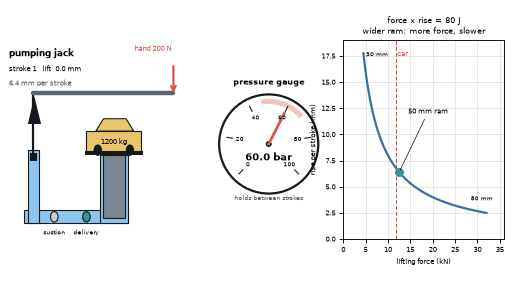
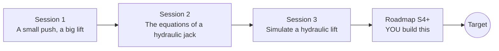

# openhydraulics

[](https://github.com/KrunalPanchal1995/openhydraulics/actions/workflows/ci.yml)   [](https://colab.research.google.com/github/KrunalPanchal1995/openhydraulics/blob/main/sessions/session-01/lesson.ipynb) [](https://krunalpanchal1995.github.io/openhydraulics/)

**Lift a car with one hand using Pascal's law, in three sessions.**

openhydraulics teaches how a small push becomes a big lift, from pressure in a liquid to a simulated hydraulic lift, using only Python and a browser.

- **Start from zero.** Session 1 needs only school arithmetic: force, area and a picture of a jack.
- **See it move.** Every session ships a slider app that runs in the browser, with labelled graphs.
- **Know you got it right.** Each session ends with a checkpoint that prints PASS or FAIL against hand calculations and exact results.
- **Build the missing half.** The repo stops at Session 3 on purpose; the roadmap shows the path to the Target.

[Target](#the-target) · [Who is this for](#who-is-this-for) · [Quick start](#quick-start) · [Sessions](#sessions) · [Roadmap](#roadmap) · [Contribute](#contribute) · [Explainer PDF](docs/explainer.pdf)

> **This repo is incomplete on purpose.** Sessions 1 to 3 are here and fully working. The finished Target below is a preview of what the community can build next. We show you the path, not the code. Sessions 4 and up are yours.

## The Target

An animated hydraulic jack: a hand lever pumps a small piston, two one-way valves let the oil go only one way, and the big ram climbs in small steps under a 1200 kg car while a pressure gauge sits near 60 bar. Beside it, a curve shows the trade-off at the heart of every hydraulic machine: the wider the ram, the more force it gives and the slower it rises. Your goal over the coming sessions: build the pumping jack with check valves yourself, and then add the details a real machine needs.



*Target: a pumping hydraulic jack, its gauge and the force versus speed trade-off*

Try it live:

- [Math Visual Studio: conservation laws for fluids (Atlas S59)](https://krunalpanchal1995.github.io/studio/#atlas?ch=S59&ex=1)
- [Math Visual Studio playground (Studio root)](https://krunalpanchal1995.github.io/studio/)

How the Target was made is shown only as a path in [promo/roadmap.md](promo/roadmap.md).

## Who is this for
**higher secondary to diploma / undergraduate (levels 4-5).** Topic area: Heat, Thermodynamics and Fluid Mechanics.

Prerequisites:

- Force, area and the idea of a square (school arithmetic and the formula for the area of a circle).
- Python 3.10 or newer; if `python --version` works, you are ready. PRIMER.md explains the rest.
- No prior GitHub, fluid mechanics or calculus experience is needed.

New to Python? Read [PRIMER.md](PRIMER.md) first (10 minutes).

## Quick start

No installation knowledge needed. You need [Git](https://git-scm.com/downloads) and [Python 3.10+](https://www.python.org/downloads/) (Windows: tick "Add Python to PATH"). On Mac and Linux type `python3` wherever this page says `python`.

```bash
git clone https://github.com/KrunalPanchal1995/openhydraulics.git
cd openhydraulics
python start.py 1
```

`start.py` creates a private environment, installs what is needed and runs Session 1 with its checkpoint. Next: `python start.py 2`, `python start.py 3`, or `python start.py test` to check everything. Only a checkpoint: `python start.py check 1`.

Four lines turn the idea of Session 1 into a result (they work as they are): Save it as `try.py` and run it with `python start.py run try.py` (this uses the private environment, where NumPy is installed):

```python
import numpy as np
A1, A2 = np.pi * 0.02**2 / 4, np.pi * 0.05**2 / 4   # piston areas in m^2 (20 mm and 50 mm)
f1 = 2000.0                                          # push on the small piston, in newtons
print(round(f1 * A2 / A1), 'N on the big piston')    # -> 12500 N, enough for a 1200 kg car (11 772 N)
```

Every session also opens in your browser with sliders (no install): [live apps](https://krunalpanchal1995.github.io/openhydraulics/). Or use the Colab badge above for the notebook.

## Sessions

| # | Session | Model level | Time | Live app |
|---|---|---|---|---|
| 1 | [A small push, a big lift](sessions/session-01/README.md) | Level 1: conceptual interactive model | 60 min | [open](https://krunalpanchal1995.github.io/openhydraulics/session-01/) |
| 2 | [The equations of a hydraulic jack](sessions/session-02/README.md) | Level 2: mathematical engineering model | 75 min | [open](https://krunalpanchal1995.github.io/openhydraulics/session-02/) |
| 3 | [Simulate a hydraulic lift](sessions/session-03/README.md) | Level 3: simulation and validation | 90 min | [open](https://krunalpanchal1995.github.io/openhydraulics/session-03/) |

Each session follows the same six steps: A real-world problem, B concept and theory, C visual explanation, D interactive simulation, E worked example and experiment, F assessment and design challenge. Each ends with `checkpoint.py`, which prints `PASS` or `FAIL` against reference numbers. Session 3 also contains the real-world mini-project: **Choose the cylinder and pump for a garage lift (educational)**.

## Architecture



| Folder or file | What is inside |
|---|---|
| `sessions/` | three sessions: README (A-F), `lesson.py`, notebook, live app, exercises, activity sheet, checkpoint |
| `promo/` | the Target: media, live links, and the roadmap (path only) |
| `docs/` | `explainer.tex` and the built `explainer.pdf` |
| `tests/` | runs every lesson and checkpoint headless |
| `start.py` | one command to set up and run anything |
| `QUALITY.md`, `RUBRIC.md` | the quality checklist and the scoring rubric |
| `.github/` | CI, PDF build, Pages deploy, issue and PR templates |

## Roadmap

| Milestone | What you will build | Difficulty |
|---|---|---|
| Session 4: Pump strokes with check valves | A stroke-by-stroke model of the jack with a suction and a delivery valve, replacing the continuous pump flow. | intermediate |
| Session 5: Air in the oil | A pump model with a dead volume between the valves that is squeezed on every stroke. | intermediate |
| Session 6: Cylinder wall and pressure rating | A small calculator that gives wall thickness from pressure, bore and allowable stress. | intermediate |
| Session 7: Controlled lowering with an orifice | A lowering simulation with a throttle valve and a chosen opening. | advanced |

Full detail with a checkpoint per milestone: [promo/roadmap.md](promo/roadmap.md).

## Contribute
New to GitHub? Read [CONTRIBUTING.md](CONTRIBUTING.md); it starts from zero. Pick an issue labelled `good first issue`. Translations into Hindi, Telugu, Tamil and Malayalam are welcome.

<details>
<summary>Development</summary>

```bash
python start.py test        # runs every lesson and checkpoint
```
Lessons use `# %%` cell markers so they open as notebooks in VS Code. See [QUALITY.md](QUALITY.md) for the standard every session meets.
</details>

## License
MIT. See [LICENSE](LICENSE). Media in `promo/media` is (c) Krunal Panchal, CC BY 4.0.

## Acknowledgments
Part of the [PAN IIT OSS](https://hellofoss.tech-iitb.org/projects) open-source teaching collection, modelled on the structure of [openspline](https://github.com/openspline/openspline). Built on ideas from the Math Visual Studio at https://krunalpanchal1995.github.io/studio/.
