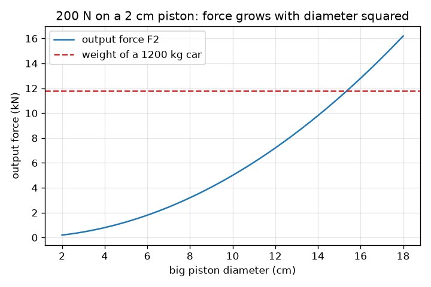
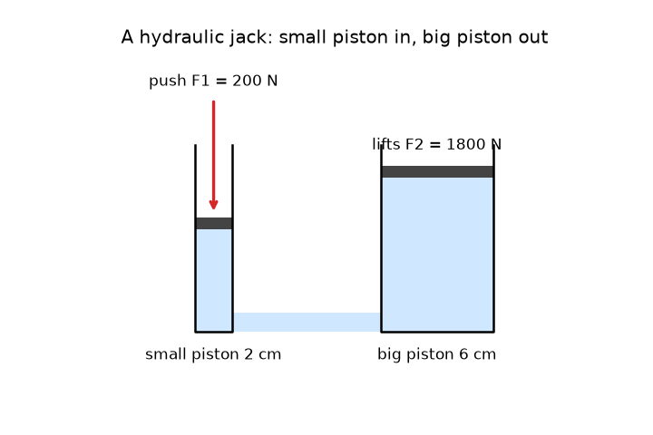

# Session 1: A small push, a big lift

*Level 1 (conceptual interactive model) · about 60 minutes · openhydraulics*

> This is a simplified educational model. It is not a validated design tool and must not be used for real structures, electrical installations, vehicles, industrial processes or medical decisions.

**Prerequisites**

- Force, area, and the area of a circle (school level).
- You have read PRIMER.md and run `python start.py 1` once.

**Learning objectives.** After this session you can:

- Explain that pressure in a liquid at rest acts equally in all directions.
- Calculate pressure as force divided by area and the force on a second piston.
- Explain why the force multiplies while the distance divides.
- Read a graph of output force against piston diameter.

## A. Real-world problem
A garage jack lifts a whole car when you pump a handle with one hand. A car weighs about 12 000 newtons, far more than you can lift, so where does the extra force come from? Nothing is magic: the liquid in the jack passes the same pressure from a small piston to a big piston, and a big piston turns that pressure into a bigger force. What do we pay for the gain?

## B. Concept and theory
Pressure is force spread over an area: p = F / A. Pascal's law says that in a liquid at rest, a pressure added at one place is felt equally in all directions and at every point of the liquid. In a two-piston machine the same pressure p acts on both pistons, so F1 / A1 = F2 / A2 and the force on the big piston is F2 = F1 (A2 / A1). The area of a round piston is A = pi d^2 / 4, so doubling the diameter makes the area, and the force, four times bigger. The liquid cannot be squashed, so the volume that leaves the small cylinder enters the big one: A1 s1 = A2 s2. The big piston therefore moves only s2 = s1 (A1 / A2): force multiplies, distance divides.

| Symbol | Meaning | Unit |
|---|---|---|
| p | pressure in the liquid | Pa (N/m^2) |
| F1, F2 | force on the small and the big piston | N |
| A1, A2 | area of the small and the big piston | m^2 |
| d1, d2 | diameter of the small and the big piston | m |
| s1, s2 | distance moved by the small and the big piston | m |

**Assumptions**

- The liquid is at rest and cannot be squashed.
- No friction at the pistons and no leakage.
- The weight of the liquid column is ignored (it is tiny in a jack).
- This is a simplified educational model, not a design tool.

$$ p=\frac{F}{A},\qquad A=\frac{\pi d^{2}}{4} $$

$$ \frac{F_1}{A_1}=\frac{F_2}{A_2}\ \Rightarrow\ F_2=F_1\,\frac{A_2}{A_1}=F_1\left(\frac{d_2}{d_1}\right)^{2} $$

$$ A_1 s_1=A_2 s_2\ \Rightarrow\ s_2=s_1\,\frac{A_1}{A_2} $$

## C. Visual explanation
The first figure is a hydraulic jack drawn to scale: a thin pump cylinder on the left, a wide cylinder on the right, both joined at the bottom and filled with liquid. A red arrow pushes the small piston down; the big piston rises, but by much less. The second figure plots the output force against the big piston diameter for a 200 N push on a 2 cm piston. It is a parabola, because force grows with the diameter squared, and it crosses the weight of a 1200 kg car (the dashed line, 11.8 kN) at a diameter of about 15.3 cm.

*Output force against big piston diameter for a 200 N push on a 2 cm piston, with the weight of a 1200 kg car.*

*A hydraulic jack to scale: the small piston moves far, the big piston moves a little.*

## D. Interactive simulation
Run the lesson (`python start.py 1`), then open the live app: [Session 1: a small push, a big lift](https://krunalpanchal1995.github.io/openhydraulics/session-01/) (or `app.html` in this folder). Change the push, the two diameters and the stroke. Watch the pressure stay the same everywhere in the picture, the car turn green when it is lifted, and the big piston move far less than the small one. Then open the force graph.

**Challenge.** Lift the 1200 kg car (11.8 kN): choose a push, the two diameters and the stroke so the car turns green.

## E. Worked example and experiment
**Problem.** A 200 N push acts on a small piston of diameter 2 cm. The big piston has diameter 6 cm. Find the pressure, the force on the big piston, the multiplier, and how far the big piston moves when the small piston moves 5 cm. Check that the work is the same on both sides.

1. Small piston area: A1 = pi * 0.02^2 / 4 = 3.142e-4 m^2.
2. Pressure: p = F1 / A1 = 200 / 3.142e-4 = 636 600 Pa = 636.6 kPa (about 6.4 times atmospheric pressure).
3. Multiplier = (d2 / d1)^2 = (6 / 2)^2 = 9, so F2 = 9 * 200 = 1800 N.
4. Distance: s2 = s1 / 9 = 50 mm / 9 = 5.6 mm.
5. Work in: 200 N * 0.05 m = 10 J. Work out: 1800 N * 0.00556 m = 10 J. They agree.

**Answer.** p = 636.6 kPa, F2 = 1800 N, multiplier 9, the big piston moves 5.6 mm, and the work in and out is 10 J.

**Experiment.** Join a small and a large plastic syringe with a short tube and fill the whole system with water, with no air bubbles. Measure the two bore diameters with a ruler and push the small plunger while a second person holds the big plunger in place against a kitchen scale or by hand. The force ratio should be close to the square of the diameter ratio. The measured ratio will be a bit lower than the model: rubber seals rub, and any air bubble squashes. The model has none of these, which is why it is only a first approximation.

## F. Assessment and design challenge
**Question type A: Conceptual.** A hydraulic jack gives a force of 1800 N from a push of 200 N. Does this break the law that energy cannot be created? Explain with the distances moved.

Hint

Compare force times distance on the two sides.

Step-by-step solution

No. The big piston moves nine times less than the small one, so the work is the same: 200 N * 0.05 m = 10 J in, and 1800 N * 0.00556 m = 10 J out. The jack trades distance for force; it does not create energy. In a real jack friction and leakage make the work out a little smaller than the work in.

**Question type B: Numerical.** A force of 300 N pushes a small piston of diameter 2.5 cm. The big piston has diameter 10 cm. Find the pressure in kPa and the force on the big piston.

Hint

Convert 2.5 cm to 0.025 m and use A = pi d^2 / 4 and p = F / A. The multiplier is (d2 / d1)^2.

Step-by-step solution

A1 = pi * 0.025^2 / 4 = 4.909e-4 m^2, so p = 300 / 4.909e-4 = 611 155 Pa = 611.2 kPa. Multiplier = (10 / 2.5)^2 = 16, so F2 = 16 * 300 = 4800 N. Sanity check: the big piston is four times wider, so its area is sixteen times larger and so is the force.

**Question type C: Graph and simulation interpretation.** In the force graph (200 N on a 2 cm piston), at which big piston diameter does the output force first equal the weight of a 1200 kg car, and what does the curve tell you about doubling the diameter?

Hint

Read where the curve crosses the dashed line, or solve 200 (d2 / 2)^2 = 11 772.

Step-by-step solution

The curve crosses the dashed line near d2 = 15.3 cm: d2 = 2 cm * sqrt(11 772 / 200) = 15.3 cm. Doubling the diameter makes the force four times bigger, which is why the curve bends upward as a parabola rather than rising in a straight line.

**Question type D: Design and optimisation challenge.** Design: you can push with 150 N on a pump piston of diameter 1.5 cm and must lift a 500 kg load (4905 N). Choose a big piston diameter, and say how far you must push to raise the load 1 cm.

Hint

The smallest diameter satisfies F2 = 4905 N. Then use s2 = s1 / multiplier.

Step-by-step solution

The smallest diameter is d2 = 1.5 cm * sqrt(4905 / 150) = 8.58 cm, so choose 9 cm. Then the multiplier is 36 and F2 = 5400 N, a margin of 10 percent. To raise the load 1 cm the pump piston must move 36 cm in total, for example six strokes of 6 cm. Trade-off: a wider big piston carries more load but needs more pumping per centimetre of lift.

Score yourself with [RUBRIC.md](../../RUBRIC.md). Print the [activity sheet](activity_sheet.md) to work on paper.

## Common misconceptions
| Common misconception | What is actually true |
|---|---|
| The pressure is bigger under the big piston because it is bigger. | The pressure is the same everywhere in the liquid. The big piston has a bigger area, so the same pressure gives a bigger force. |
| A hydraulic jack makes energy. | It makes force bigger and distance smaller. Work in equals work out for an ideal jack, and a real jack loses a little. |
| Pressure only pushes downward, as the liquid weight does. | Pressure in a liquid at rest pushes equally in all directions, onto the walls and pistons alike. |
| Doubling the piston diameter doubles the force. | The force follows the area, which goes with the diameter squared, so doubling the diameter makes the force four times bigger. |

## Glossary
- **pressure**: force divided by the area it acts on; measured in pascals
- **pascal (Pa)**: one newton per square metre; 1000 Pa is 1 kPa
- **Pascal's law**: pressure added to a liquid at rest is passed on equally in all directions
- **piston**: a disc that slides in a cylinder and pushes on the liquid
- **multiplier**: the ratio of output force to input force, A2 / A1

## Finish
1. Do the three coding tasks in [exercises.md](exercises.md).
2. Run `python start.py 1` again after your changes. It ends with the checkpoint; when it prints `PASS`, you are done. (Checkpoint only: `python start.py check 1`.)

Next: [Session 2](../session-02/README.md)
