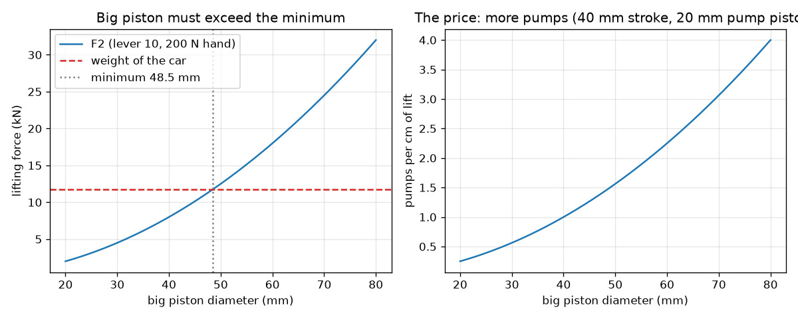
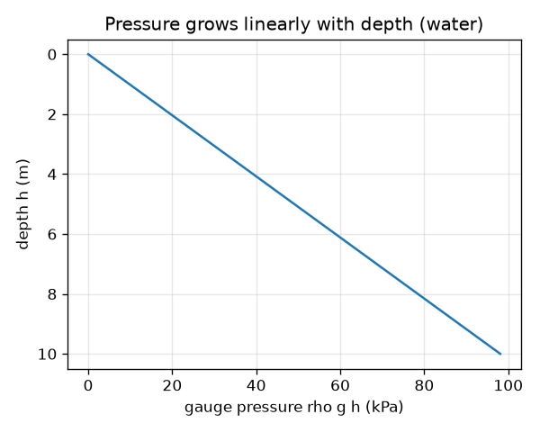

# Session 2: The equations of a hydraulic jack

*Level 2 (mathematical engineering model) · about 75 minutes · openhydraulics*

> This is a simplified educational model. It is not a validated design tool and must not be used for real structures, electrical installations, vehicles, industrial processes or medical decisions.

**Prerequisites**

- Session 1: pressure and Pascal's law.
- Square roots and unit conversion (mm to m, Pa to bar).

**Learning objectives.** After this session you can:

- Use p = F / A, F2 = F1 (A2 / A1) and the work balance with correct units (Pa, kPa, bar).
- Calculate hydrostatic pressure p = rho g h and say when it can be ignored.
- Combine a lever and two pistons to find the mechanical advantage.
- Solve the design problem: piston diameters, lever and pumps per centimetre for a given car.

## A. Real-world problem
A workshop wants to lift a 1200 kg car by pushing a lever with no more than 200 N. How wide must the pistons be? How long a lever do we need? And how many pumps of the handle does each centimetre of lift cost? Answering needs the equations of Session 1 with careful units, and a first look at the pressure that the weight of a liquid itself makes.

## B. Concept and theory
Pressure is p = F / A and is measured in pascals (1 Pa = 1 N/m^2); we also use kPa (1000 Pa) and bar (100 000 Pa, close to one atmosphere, 101 325 Pa). Pascal's law gives F2 = F1 (A2 / A1), and the mechanical advantage is MA = F2 / F1 = A2 / A1. For an ideal jack the liquid volume moved is equal on both sides, A1 d1 = A2 d2, so F1 d1 = F2 d2: the work put in equals the work got out. Separately, a liquid at rest has a pressure that grows with depth h because of its own weight: p = rho g h (gauge pressure). In an open tank the absolute pressure is p_atm + rho g h. A lever of ratio r (handle length divided by the distance from the pivot to the pump piston) multiplies the hand force, F1 = r F_hand, while the handle moves r times as far as the pump piston. The car must satisfy F2 >= m g, so A2 >= A1 m g / F1. One pump stroke s1 raises the car by s1 / MA, so the number of pumps per centimetre is 0.01 m / (s1 / MA).

| Symbol | Meaning | Unit |
|---|---|---|
| p | pressure | Pa, kPa or bar |
| F, F1, F2 | force (hand lever output, pump piston, big piston) | N |
| A1, A2 | pump piston and big piston area | m^2 |
| MA | mechanical advantage A2 / A1 | no unit |
| rho | liquid density (oil 870, water 1000) | kg/m^3 |
| g | gravity, 9.81 | m/s^2 |
| h | depth below the surface | m |
| r | lever ratio | no unit |
| s1 | pump piston stroke | m |
| m | mass of the car | kg |

**Assumptions**

- Ideal jack: no friction, no leakage, liquid cannot be squashed.
- The pump has check valves that let it refill between strokes (not modelled).
- The oil column in the jack is short, so rho g h is ignored there.
- Safety-critical: this is a simplified educational model, not a design tool; real jacks need certified design, pressure ratings and safety locks.

$$ p=\frac{F}{A},\qquad 1\ \mathrm{bar}=10^{5}\ \mathrm{Pa} $$

$$ F_2=F_1\frac{A_2}{A_1},\qquad \mathrm{MA}=\frac{A_2}{A_1},\qquad F_1 d_1=F_2 d_2 $$

$$ p=\rho g h,\qquad p_{\mathrm{abs}}=p_{\mathrm{atm}}+\rho g h $$

$$ F_1=r F_{\mathrm{hand}},\qquad d_{2,\min}=d_1\sqrt{\frac{m g}{F_1}} $$

$$ \text{pumps per cm}=\frac{0.01\ \mathrm{m}}{s_1/\mathrm{MA}} $$

## C. Visual explanation
The first figure has two graphs for the design problem (lever 10, 200 N hand push, 20 mm pump piston, 40 mm stroke). On the left the lifting force rises with the square of the big piston diameter; it crosses the car weight (dashed line, 11.8 kN) at a minimum of 48.5 mm. On the right the price appears: pumps per centimetre also rise with the square of the diameter, from 0.4 at 20 mm to 6.4 at 80 mm, so a wider piston lifts more but needs more pumping. The second figure shows hydrostatic pressure growing in a straight line with depth, 98.1 kPa at 10 m of water.

*Design curves: force and pumps per centimetre against big piston diameter.*

*Hydrostatic pressure grows in a straight line with depth (water).*

## D. Interactive simulation
Run the lesson (`python start.py 2`), then open the live app: [Session 2: design a hydraulic jack](https://krunalpanchal1995.github.io/openhydraulics/session-02/) (or `app.html` in this folder). Move the sliders for the hand push, the lever, the two piston diameters, the stroke and the car mass. Watch the force graph, the pumps-per-centimetre graph and the readout change together.

**Challenge.** Lift the 1200 kg car and keep the cost to at most 2 pumps per centimetre of lift.

## E. Worked example and experiment
**Problem.** Lift a 1200 kg car with a hand push of 200 N, a lever of ratio 10, a pump piston of 20 mm and a stroke of 40 mm. Find the smallest big piston, then check the choice of 50 mm: the pressure, the mechanical advantage, the lifting force, the lift per stroke, the number of pumps per centimetre and the work balance.

1. Weight W = m g = 1200 * 9.81 = 11 772 N. Force on the pump piston F1 = 10 * 200 = 2000 N.
2. Smallest big piston: d2 = d1 sqrt(W / F1) = 20 mm * sqrt(11 772 / 2000) = 20 * 2.426 = 48.5 mm. Choose the next convenient size, 50 mm.
3. Areas: A1 = pi * 0.020^2 / 4 = 3.142e-4 m^2 and A2 = pi * 0.050^2 / 4 = 1.963e-3 m^2, so MA = 6.25.
4. Pressure p = F1 / A1 = 2000 / 3.142e-4 = 6.37 MPa = 63.7 bar. Force F2 = 6.25 * 2000 = 12 500 N, which is above 11 772 N (6 percent margin).
5. Lift per stroke = 40 mm / 6.25 = 6.4 mm, so pumps per cm = 10 mm / 6.4 mm = 1.56. The handle moves 10 * 40 = 400 mm per stroke.
6. Work balance: F1 * 0.040 m = 80 J and F2 * 0.0064 m = 80 J. They agree.

**Answer.** Minimum big piston 48.5 mm; with 50 mm: MA 6.25, F2 = 12 500 N, p = 63.7 bar, 6.4 mm lift per stroke, 1.56 pumps per cm, 80 J of work per stroke in and out.

**Experiment.** Use a bottle jack in a workshop or a school lab under supervision. Count how many handle strokes raise a known load by 1 cm and compare with the model: the real number is higher, because friction, leakage and the compression of the oil (and any air) waste part of each stroke. Also compare the handle force you feel with the model. Model versus reality: the ideal model gives the minimum effort; real jacks need extra force and extra strokes.

## F. Assessment and design challenge
**Question type A: Conceptual.** Why can we ignore rho g h inside the jack, but not when we design a dam or a diving bell?

Hint

Compare rho g h for 0.5 m of oil with the jack pressure of about 6 MPa, and with 10 m of water.

Step-by-step solution

The oil column in a jack is about 0.5 m tall, so rho g h = 870 * 9.81 * 0.5 = 4.27 kPa, less than 0.1 percent of the 6.37 MPa made by the pistons. A dam or diving bell has tens of metres of water: at 10 m rho g h = 98.1 kPa, about one atmosphere, and it keeps growing with depth, so it dominates the design.

**Question type B: Numerical.** Find the gauge pressure and the absolute pressure at 30 m depth in fresh water (rho = 1000 kg/m^3). Give the answers in kPa and bar.

Hint

Gauge pressure is rho g h; add 101 325 Pa for the absolute pressure.

Step-by-step solution

Gauge pressure = 1000 * 9.81 * 30 = 294 300 Pa = 294.3 kPa = 2.94 bar. Absolute pressure = 294 300 + 101 325 = 395 625 Pa = 395.6 kPa = 3.96 bar. Sanity check: every 10 m of water adds about 1 bar.

**Question type C: Graph and simulation interpretation.** From the design graphs (lever 10, 200 N hand, 20 mm pump piston, 40 mm stroke), how many pumps per centimetre do you need with a 60 mm big piston, and does it lift the car?

Hint

MA = (60 / 20)^2. Lift per stroke = stroke / MA.

Step-by-step solution

MA = 9, F2 = 9 * 2000 = 18 000 N, which is more than 11 772 N, so it lifts the car easily. Lift per stroke = 40 / 9 = 4.44 mm, so pumps per cm = 10 / 4.44 = 2.25. Compared with the 50 mm choice (1.56 pumps per cm) the extra force margin costs about 44 percent more pumping.

**Question type D: Design and optimisation challenge.** Design: a 1500 kg van, hand push 150 N, lever 8, pump piston 16 mm, stroke 30 mm. Find the minimum big piston, choose a standard 60 mm piston, and give the pressure and the number of pumps per cm. Discuss one trade-off.

Hint

F1 = 8 * 150 = 1200 N. Use d2 = d1 sqrt(m g / F1) for the minimum.

Step-by-step solution

W = 1500 * 9.81 = 14 715 N. Minimum d2 = 16 * sqrt(14 715 / 1200) = 56.0 mm, so 60 mm works: MA = 14.06 and F2 = 16 875 N (15 percent margin). Pressure = 1200 / (pi * 0.016^2 / 4) = 5.97 MPa = 59.7 bar. Lift per stroke = 30 / 14.06 = 2.13 mm, so 4.69 pumps per cm, and the handle moves 240 mm per stroke. Trade-off: a wider ram gives more margin but more strokes; a longer lever would cut the number of strokes needed for a given force but makes the handle longer.

Score yourself with [RUBRIC.md](../../RUBRIC.md). Print the [activity sheet](activity_sheet.md) to work on paper.

## Common misconceptions
| Common misconception | What is actually true |
|---|---|
| The pressure in the jack is the weight of the oil. | The jack pressure comes from the pistons (about 64 bar); the oil's own weight adds only a few kPa. |
| A bar is a big unit. | One bar is 100 000 Pa and close to the atmospheric pressure we always live in (1.013 bar). |
| More mechanical advantage is always better. | It costs distance: a bigger MA means more strokes per centimetre of lift. |
| Use the diameter ratio (not squared) for the multiplier. | Force follows area, so the multiplier is the square of the diameter ratio. |

## Glossary
- **mechanical advantage**: the ratio of output force to input force
- **gauge pressure**: pressure above the atmosphere
- **absolute pressure**: gauge pressure plus atmospheric pressure
- **hydrostatic pressure**: the pressure rho g h caused by the weight of a liquid column
- **bar**: a pressure unit equal to 100 000 Pa
- **stroke**: the distance a piston moves in one push

## Finish
1. Do the three coding tasks in [exercises.md](exercises.md).
2. Run `python start.py 2` again after your changes. It ends with the checkpoint; when it prints `PASS`, you are done. (Checkpoint only: `python start.py check 2`.)

Next: [Session 3](../session-03/README.md)
