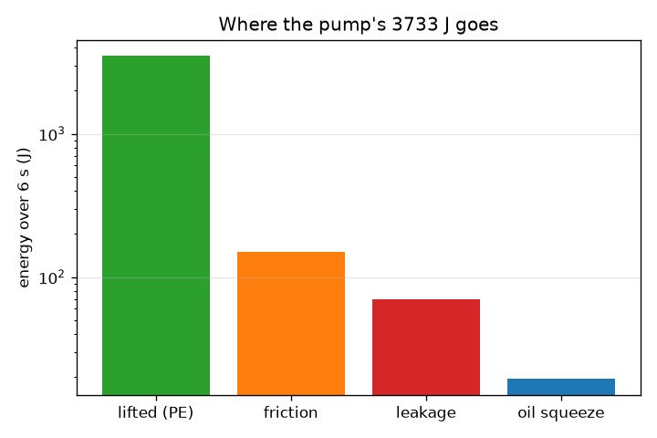
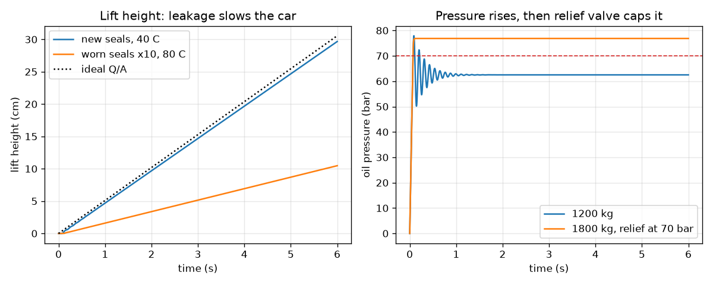

# Session 3: Simulate a hydraulic lift

*Level 3 (simulation and validation) · about 90 minutes · openhydraulics*

> This is a simplified educational model. It is not a validated design tool and must not be used for real structures, electrical installations, vehicles, industrial processes or medical decisions.

**Prerequisites**

- Session 1 and 2: Pascal's law, pressure, work.
- The idea of a speed as distance divided by time; no calculus is needed.

**Learning objectives.** After this session you can:

- Build a time-stepping model of a pump, cylinder, relief valve, leakage, friction and compressible oil.
- Validate it against the exact lift speed v = Q / A, an energy balance and a plateau-pressure formula.
- Measure how leakage and oil temperature change the lift.
- Explain what happens when the load is too heavy for the relief valve setting.

## A. Real-world problem
A garage lift is not a hand jack: an electric pump pushes oil at a steady flow into a big cylinder under the car, and a relief valve protects the system from too much pressure. Oil leaks past the seals, seals rub, and the oil can be squashed a tiny bit, which makes the car bounce slightly on its hydraulic spring. How fast does the car rise, where does the pump's energy go, and what happens when a heavier car is put on the lift? (This is an educational model: real lifts need certified design, check valves and mechanical safety locks.)

## B. Concept and theory
The unknowns are the ram position x, speed v and oil pressure p. The pump flow Q splits three ways: it moves the piston (A v), it leaks (c p, a laminar leak proportional to the pressure) and, if p exceeds the relief setting p_set, it escapes through the relief valve (k_r (p - p_set)). Oil is slightly compressible with bulk modulus B, so the pressure changes as dp/dt = (B / V)(Q - A v - c p - Q_relief), with V = V0 + A x. Newton's second law for the load is m dv/dt = p A - m g - c_f v, where c_f v is the seal friction; the floor holds the load while x = 0. These two equations are a spring-mass-damper: the oil acts as a spring of stiffness k = B A^2 / V, friction is the damper, and the car rings at f = sqrt(k / m) / (2 pi). The viscosity of hydraulic oil falls steeply when it warms (a rough fit used here: it halves about every 22 C), and laminar leakage is inversely proportional to viscosity, so c = c40 * wear * exp(0.0318 (T - 40)) grows with temperature T (C). We step the equations with dt = 0.2 ms (semi-implicit Euler) and keep running totals of the energies. Exact references: without leakage the steady speed is v = Q / A; with leakage and friction v = (Q - c m g / A) / (A + c c_f / A); if the load is too heavy the pressure sits on the plateau p = (Q + k_r p_set) / (c + k_r).

| Symbol | Meaning | Unit |
|---|---|---|
| Q | pump flow | m^3/s (1 L/min = 1.667e-5) |
| A | ram area (50 mm diameter: 19.63 cm^2) | m^2 |
| p, p_set | oil pressure, relief valve setting | Pa |
| B | bulk modulus of the oil (1.5 GPa) | Pa |
| V0, V | oil volume at zero lift, and V0 + A x | m^3 |
| c, c_f | leakage coefficient, seal friction coefficient | m^3/(s Pa), N s/m |
| k_r | relief valve flow per excess pressure | m^3/(s Pa) |
| m, x, v | load mass, lift height, lift speed | kg, m, m/s |
| T, wear | oil temperature, leakage multiplier for worn seals | C, no unit |

**Assumptions**

- One vertical ram under a rigid platform, no tilt.
- Laminar leakage proportional to pressure; viscous (linear) seal friction.
- Constant bulk modulus; viscosity fit is rough and for illustration.
- The relief valve is a linear spring-loaded valve that passes the full pump flow at 10 percent over its setting.
- No check valves, hoses, pump efficiency or heating of the oil: a simplified educational model, not a design tool.

$$ \frac{dp}{dt}=\frac{B}{V_0+A x}\Big(Q-A\,v-c\,p-Q_{\mathrm{rel}}\Big),\qquad Q_{\mathrm{rel}}=k_r\max(0,\,p-p_{\mathrm{set}}) $$

$$ m\frac{dv}{dt}=pA-mg-c_f v,\qquad \frac{dx}{dt}=v $$

$$ k=\frac{B A^{2}}{V},\qquad f=\frac{1}{2\pi}\sqrt{\frac{k}{m}} $$

$$ v=\frac{Q}{A}\ (c=0),\qquad v=\frac{Q-c\,m g/A}{A+c\,c_f/A} $$

$$ W_{\mathrm{in}}=\int pQ\,dt=mgx+\tfrac12 mv^{2}+\int c_f v^{2}dt+\int c\,p^{2}dt+W_{\mathrm{rel}}+E_{\mathrm{oil}} $$

$$ p_{\mathrm{plateau}}=\frac{Q+k_r p_{\mathrm{set}}}{c+k_r} $$

## C. Visual explanation
The first figure has two panels. On the left, the lift height against time: with new seals the car climbs in a straight line at about 5 cm/s to 29.7 cm in 6 s, just under the dotted ideal line Q/A; with worn seals (10 times the leakage) and oil at 80 C it reaches only 10.5 cm, because the oil is thin and leaks more. On the right, the pressure rises in a fraction of a second to the 60 bar the load needs and ripples slightly (the oil spring ringing at about 9 Hz); for a 1800 kg load on a 70 bar valve it flattens at 76.8 bar, the relief plateau, and the car never leaves the floor. The second figure is the energy budget on a log scale: over 93 percent of the pump work becomes lifted energy; friction, leakage and the compression of the oil take the rest.

*Where the pump's energy goes in 6 s (log scale).*

*Left: lift height with new and worn seals. Right: pressure rises, then the relief valve caps it for an overloaded lift.*

## D. Interactive simulation
Run the lesson (`python start.py 3`), then open the live app: [Session 3: a simulated hydraulic lift](https://krunalpanchal1995.github.io/openhydraulics/session-03/) (or `app.html` in this folder). Change the pump flow, load, relief setting, oil temperature, seal wear and oil stiffness. Watch the lift, the pressure gauge and the relief valve in the picture, then open the height and pressure graphs.

**Challenge.** Find a load that the relief valve cannot carry: the pressure the load needs, m g / A, must be above the relief setting, and the car stays on the floor.

## E. Worked example and experiment
**Problem.** A 1200 kg car sits on a 50 mm ram. The pump delivers 6 L/min (1e-4 m^3/s), new seals leak with c = 3e-13 m^3/(s Pa) at 40 C, seal friction is c_f = 10 000 N s/m and the relief valve is set to 80 bar. Find the pressure the load needs, the ideal lift speed, the speed with leakage and friction, and what the 6 s simulation gives for the lift and the energy.

1. Ram area A = pi * 0.050^2 / 4 = 1.9635e-3 m^2. Load pressure = m g / A = 11 772 / 1.9635e-3 = 5.996e6 Pa = 60.0 bar, below the 80 bar setting, so the relief valve stays closed.
2. Ideal speed v = Q / A = 1e-4 / 1.9635e-3 = 0.05093 m/s = 50.93 mm/s, so 6 s would give 30.6 cm.
3. Leakage flow at the load pressure: c p = 3e-13 * 5.996e6 = 1.8e-6 m^3/s, which is 1.8 percent of the pump flow.
4. Speed with leakage and friction: v = (1e-4 - 3e-13 * 11 772 / 1.9635e-3) / (1.9635e-3 + 3e-13 * 10 000 / 1.9635e-3) = 0.04997 m/s = 49.97 mm/s.
5. The simulation lifts the car 29.7 cm in 6 s (the oil first has to be squeezed to 60 bar, which costs about 0.3 cm) with a mean speed of 49.97 mm/s over the last 3 s.
6. Energy: the pump puts in 3733 J; lifted energy m g x = 3493 J (93.6 percent), friction 150 J, leakage 70 J, oil compression 19 J, kinetic 1.5 J. These add up to the input within 0.2 J.

**Answer.** Load pressure 60.0 bar; ideal speed 50.93 mm/s; speed with leakage and friction 49.97 mm/s (the simulation agrees); lift 29.7 cm in 6 s; 93.6 percent of the 3733 J pump work becomes lifted energy and the energy budget closes within 0.2 J.

**Experiment.** Time a real service lift (with the workshop's permission) over a known height with a stopwatch and compare with v = Q / A for the pump flow on its data plate. Repeat when the oil is cold and after it has warmed up. The measured speed will be a few percent below Q / A, and slower with warm oil if the seals are worn. The model differs from reality because it ignores the hoses, the efficiency of the pump, the heating of the oil and the compliance of the structure.

## Real-world application and mini-project: Choose the cylinder and pump for a garage lift (educational)
A small garage wants a lift for cars up to 1500 kg. The relief valve is fixed at 100 bar. Choose a ram diameter from 40, 50, 63 and 80 mm and a pump flow from 3, 6, 9, 12 and 15 L/min. A design passes if (1) with new seals at 40 C the average lift speed between 4 s and 8 s is 4.0 to 6.0 cm/s, (2) with worn seals and hot oil (`wear=5.0`, `T=80.0`) it is still at least 2.5 cm/s, and (3) the pressure peak stays below 100 bar so the relief valve never opens. Use `simulate(mass=1500.0, d=..., Q=..., p_relief=1.0e7, t_end=8.0)` and `mean_speed(s, 4.0)` from Session 3. Among the passing designs prefer the smallest pump flow. This is an educational exercise only: a real lift needs certified design, check valves, hoses rated for the pressure and mechanical safety locks.

**Deliverable:** A script that loops over all 20 combinations, prints for each the new-seal speed, the hot worn-seal speed and the pressure peak, marks which pass, names the preferred design, and saves a picture of the lift height against time for the preferred design with new and with worn seals.

**Success looks like:** Exactly three designs pass (50 mm with 6 L/min, 63 mm with 9 L/min and 80 mm with 15 L/min), and the preferred one is 50 mm with 6 L/min (4.97 cm/s new, 3.01 cm/s worn and hot, peak 94.8 bar).

## F. Assessment and design challenge
**Question type A: Conceptual.** Why does a lift with worn seals rise more slowly when the oil is hot than when it is cold, even though the pump has not changed?

Hint

Think about viscosity and the flow past the seals.

Step-by-step solution

Hot oil is thinner (its viscosity is lower), so it flows more easily past worn seals: the leakage coefficient c grows with temperature. Part of the constant pump flow Q now leaks instead of moving the ram, so v = (Q - c m g / A) / (...) falls. For new seals the leakage is only about 2 percent of Q and the effect is small; for worn seals at 80 C it takes more than half of the flow.

**Question type B: Numerical.** A 1800 kg load stands on the 50 mm ram. What pressure does it need? Can a relief valve set to 70 bar let the lift work? What is the plateau pressure of that valve with the 6 L/min pump (k_r = Q / (0.1 p_set), c = 3e-13)?

Hint

p = m g / A. The plateau is p = (Q + k_r p_set) / (c + k_r).

Step-by-step solution

p = 1800 * 9.81 / 1.9635e-3 = 8.99e6 Pa = 89.9 bar, above 70 bar, so the load cannot be lifted. k_r = 1e-4 / (0.1 * 7e6) = 1.43e-10 m^3/(s Pa), so p_plateau = (1e-4 + 1.43e-10 * 7e6) / (3e-13 + 1.43e-10) = 76.8 bar. The pump pushes oil over the valve at 76.8 bar, which is below the 89.9 bar needed, so the ram does not move. The valve protects the system; it does not lift the car.

**Question type C: Graph and simulation interpretation.** In the left graph, the worn-seal curve at 80 C is a straight line at a lower slope. What is that slope in cm/s, and what would the slope of the ideal line be?

Hint

Slope = lift speed. Use the formula v = (Q - c m g / A) / (A + c c_f / A) with c = 1.07e-11 m^3/(s Pa), or read the end of the curve.

Step-by-step solution

The ideal slope is Q / A = 5.09 cm/s. For the worn seal at 80 C, c = 3e-13 * 10 * exp(0.0318 * 40) = 1.07e-11, so the leak flow c m g / A = 6.4e-5 m^3/s, which is 64 percent of Q, and v = 1.78 cm/s (simulated: 10.5 cm in 6 s, with the first 0.3 s spent squeezing the oil). The curve is a straight line because the speed is steady once the pressure has settled to the load pressure.

**Question type D: Design and optimisation challenge.** Design: with worn seals (wear 10) and hot oil (80 C), choose a pump flow in whole L/min so that the 1200 kg car still rises at least 25 cm in 6 s, with the relief valve at 80 bar. Which flow works and what does it cost in hydraulic power p Q?

Hint

Try Q values with `lift_after(wear=10.0, T=80.0, Q=...)`; the required mean speed is about 4.2 cm/s.

Step-by-step solution

The simulation gives 20.3 cm at 8 L/min, 25.3 cm at 9 L/min and 30.2 cm at 10 L/min; so 9 L/min is the smallest whole-number flow that meets the 25 cm target (a 1 percent margin; 10 L/min gives a bigger one). The pressure peak is 73.6 bar, below the relief setting. Hydraulic power p Q = 6.0e6 Pa * 1.5e-4 m^3/s = 900 W at 9 L/min, against 600 W for the normal 6 L/min, so the price of tolerating worn seals is a pump that is 50 percent bigger and a motor that draws more power. Replacing the seals is cheaper.

Score yourself with [RUBRIC.md](../../RUBRIC.md). Print the [activity sheet](activity_sheet.md) to work on paper.

## Common misconceptions
| Common misconception | What is actually true |
|---|---|
| Hydraulic oil cannot be compressed at all. | It is compressed by a very small fraction (B = 1.5 GPa: about 0.4 percent at 60 bar). That small effect is what makes the car ring on a hydraulic spring, and air bubbles make it much bigger. |
| The relief valve lifts a heavy load by being strong. | It protects the system: it opens at its setting and returns the pump flow to the tank. If the load needs more pressure than the setting, the ram does not move. |
| Leakage is the same at any temperature. | Warm oil is thinner and leaks more; temperature changes leakage a lot. |
| If the simulation agrees with Q / A the model is validated. | That is one check. We also check energy, the oil spring frequency and the plateau pressure, and we still do not claim it is a design tool. |

## Glossary
- **flow rate Q**: volume of oil delivered per second
- **relief valve**: a valve that opens above a set pressure to protect the system
- **bulk modulus**: how stiff a liquid is against compression
- **viscosity**: how thick a liquid is; thin oil flows more easily
- **leakage**: oil that escapes past the seals instead of moving the ram
- **spring-mass-damper**: a model with a spring, a mass and friction
- **plateau**: a pressure that stays level while the relief valve passes the pump flow

## Finish
1. Do the three coding tasks in [exercises.md](exercises.md).
2. Run `python start.py 3` again after your changes. It ends with the checkpoint; when it prints `PASS`, you are done. (Checkpoint only: `python start.py check 3`.)

Next: the [roadmap](../../promo/roadmap.md). Session 4 is yours to build.
